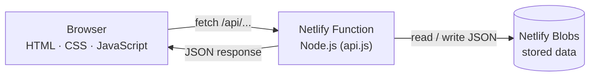
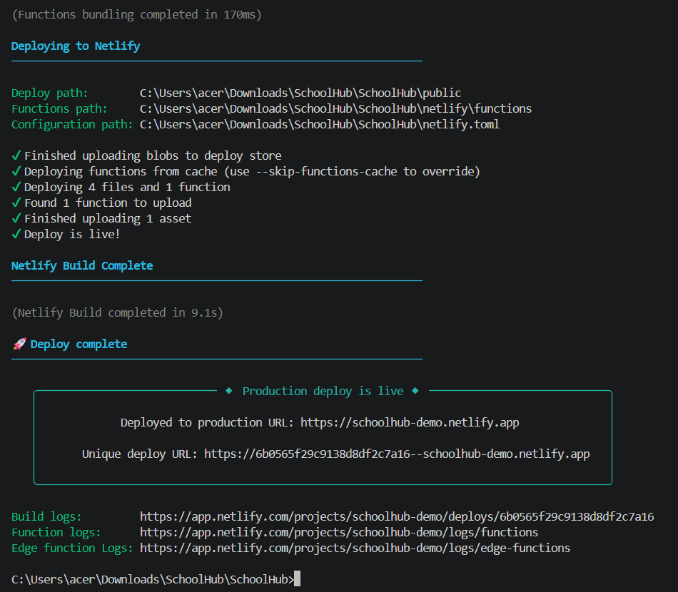

<div align="center">

# 🎓 SchoolHub

**A simple, modern school management system built with plain HTML, CSS and JavaScript on a serverless Netlify backend.**

[](https://schoolhub-demo.netlify.app)


[**Open the live app**](https://schoolhub-demo.netlify.app) · [**Read the handbook (PDF)**](Documentation/SchoolHub_Project_Handbook.pdf) · [**WhatsApp technical report (PDF)**](Documentation/SchoolHub_WhatsApp_Technical_Findings.pdf) · [**Setup guide**](#-run-it-locally)

</div>

> [!NOTE]
> SchoolHub is a **demonstration project**. It has no login and is **not intended for real student personal information**. Please use only sample or made-up data.

---

## 📑 Table of Contents

- [Project Status](#-project-status)
- [Overview](#-overview)
- [Objectives](#-objectives)
- [Key Features](#-key-features)
- [Technology Stack](#-technology-stack)
- [Application Modules](#-application-modules)
- [How It Works](#-how-it-works)
- [Architecture](#-architecture)
- [Repository Structure](#-repository-structure)
- [Run It Locally](#-run-it-locally)
- [Deployment](#-deployment)
- [Development Journey](#-development-journey)
- [WhatsApp Integration](#-whatsapp-integration--technical-investigation)
- [Testing](#-testing)
- [Known Limitations](#-known-limitations)
- [Future Enhancements](#-future-enhancements)
- [Documentation](#-documentation)
- [Credits](#-credits)

---

## 📌 Project Status

| Area | Status |
|---|---|
| ✅ **Core SchoolHub application** |  |
| ✅ **Local API testing** |  |
| ✅ **WhatsApp API research** |  |
| ✅ **Technical documentation** |  |
| ⚠️ **WhatsApp integration** |  |
| ⚠️ **Updated ZIP integration** |  |
| 🚫 **Outgoing WhatsApp delivery** |  |
| ⏳ **Business verification** |  |

> [!IMPORTANT]
> The repository retains the original working demonstration application. WhatsApp integration was partially implemented in an experimental package, not validated or deployed. Automatic outgoing WhatsApp notifications are not operational.

## 🌟 Overview

SchoolHub lets a school office keep track of its **students, teachers and classes** and record **daily attendance** from one clean dashboard that runs in any web browser.

It was built as a lightweight demonstration: a complete, working web application with a real backend and permanent storage, deliberately kept small and free of heavy tooling. There is no React, PostgreSQL, MongoDB or Docker, and there is no build step.

**Live application:** https://schoolhub-demo.netlify.app

## 🎯 Objectives

- Manage students, teachers and classes in one simple system.
- Record attendance by class and date, and review earlier records.
- Store data permanently so it is still there after a refresh or a later visit.
- Present everything in a clean, modern interface designed for desktop and mobile screens.
- Publish the project as a live website on Netlify.

## ✨ Key Features

| Module | What you can do |
|---|---|
| 📊 **Dashboard** | See total students, teachers and classes; today's present and absent counts; a ring chart for today and a bar chart for the last 7 days |
| 🧑‍🎓 **Students** | Add, view, edit and delete students; search as you type |
| 👩‍🏫 **Teachers** | Add, view, edit and delete teachers |
| 🏫 **Classes** | Add, edit and delete classes; assign a teacher to each class |
| ✅ **Attendance** | Pick a class and date, mark each student Present or Absent, save, and view previously saved records |
| 🧪 **Demo Data** | Load clearly labelled sample records, explore the app, then clear everything |

Also included: form validation, success and error messages, friendly empty states, confirmation before deleting, and protection against duplicate admission numbers.

## 🛠 Technology Stack

| Layer | Technology | Role |
|---|---|---|
| Frontend | HTML5, CSS3, Vanilla JavaScript | Pages, styling, forms, charts and API calls in the browser. No framework |
| Backend | Node.js, Netlify Functions | One serverless function that serves every `/api/*` route and validates data |
| Data storage | Netlify Blobs | Simple key-value storage holding the records as JSON |
| Hosting | Netlify | Serves the static site and runs the function |

**Deliberately not used:** React, PostgreSQL, MongoDB, Docker, a login system, and a GitHub-connected deployment workflow.

## 🧩 Application Modules

### Students
Stores **name, admission number, class, parent name and contact number**. Name, admission number and class are required. Admission numbers must be unique (compared ignoring capital letters). The list can be searched by name, admission number, class, parent or contact.

### Teachers
Stores **name, subject and contact number**. Name and subject are required. The teachers table also shows which class each teacher leads.

### Classes
Stores a **class name** (unique) and an optional **class teacher**. The table shows how many students are in each class.

### Attendance
Attendance is saved **per class and per date**. After choosing a class, its students are listed and everyone starts as Present. Each can be switched to Absent, and a *Mark all present* button is provided. Opening a saved date again shows the saved result for editing. A **Saved records** table lists every saved date and class with present and absent counts.

### Demo Data
*Load sample data* adds 3 classes, 3 teachers, 12 students and 5 days of attendance, each tagged **Sample**. It only loads when the system is empty. *Clear all data* removes every record after a confirmation.

### Data rules
- Deleting a **teacher** leaves their classes without a teacher.
- Deleting a **class** keeps its students, but they will have no class.
- Saved attendance keeps a copy of student names, so history stays readable even if a student is later deleted.

## ⚙️ How It Works

1. The browser loads a single page (`index.html`) and the script `app.js`, which switches between modules without reloading.
2. When you add, edit, delete or save something, the script sends a request to `/api/...`.
3. One Netlify Function (`api.js`) receives the request, validates it and reads or writes data in Netlify Blobs.
4. The function replies with JSON, and the page updates and shows a success or error message.

### API routes

| Route | Methods | Purpose |
|---|---|---|
| `/api/students`, `/api/teachers`, `/api/classes` | `GET`, `POST` | List all, or create one |
| `/api/<type>/:id` | `PUT`, `DELETE` | Edit or delete one record |
| `/api/attendance?date=YYYY-MM-DD&classId=...` | `GET` | Fetch the saved attendance for a class and date |
| `/api/attendance` | `POST` | Save attendance for a class and date |
| `/api/attendance/history` | `GET` | List all saved attendance records |
| `/api/dashboard?date=YYYY-MM-DD` | `GET` | Totals, today's summary and the last 7 days |
| `/api/seed`, `/api/clear` | `POST` | Load or remove demo data |

### How data is stored
Netlify Blobs keeps one store named `schoolhub`:

| Key | Content |
|---|---|
| `students`, `teachers`, `classes` | A JSON list of records |
| `attendance/<date>/<classId>` | One saved attendance record |

## 🏗 Architecture

> *Illustrative diagram, not a screenshot.*



Everything runs on Netlify: the static files in `public/` and the single function in `netlify/functions/`. There is no database server and no build step.

## 📁 Repository Structure

```
SchoolHub-Project/
├── README.md                          ← you are here
├── .gitignore
│
├── Application/                       ← the complete SchoolHub app (deploy from here)
│   ├── public/
│   │   ├── index.html
│   │   ├── css/style.css
│   │   └── js/app.js
│   ├── netlify/
│   │   └── functions/api.js           ← the whole backend
│   ├── netlify.toml                   ← Netlify settings
│   ├── package.json
│   ├── package-lock.json
│   └── README.md                      ← original app setup guide
│
└── Documentation/
    ├── SchoolHub_Project_Handbook.pdf ← 10-page project handbook
    ├── SchoolHub_WhatsApp_Technical_Findings.pdf ← continuation, pages 11–19
    ├── SchoolHub_Handbook_Source/     ← editable source used to build the handbook
    │   ├── build_handbook.py
    │   ├── terminal_screenshot.png
    │   └── README.txt
    └── images/
        └── production-deploy-terminal.png
```

## 💻 Run It Locally

**Requirements:** [Node.js](https://nodejs.org) (a supported LTS version compatible with the project and Netlify CLI), npm, and a Netlify account for deployment.

```bash
# 1. Get the project (replace the placeholder with your repository's URL)
git clone <your-repository-url>
cd SchoolHub-Project/Application

# 2. Install the dependency
npm install

# 3. Install the Netlify CLI (once)
npm install -g netlify-cli

# 4. Start the local server
netlify dev
```

Then open **http://localhost:8888**. Locally, data is kept in a temporary store that is separate from the live site. If you prefer not to install the CLI globally, use `npx netlify-cli dev` instead.

> [!TIP]
> Always run the commands from inside the **`Application`** folder. That is where `package.json` and `netlify.toml` live.

## 🚀 Deployment

SchoolHub was deployed **directly from the local project folder using Netlify CLI**. **No GitHub repository was connected to Netlify.**

```bash
cd Application
npm install                 # install dependencies (once)
netlify login               # sign in to Netlify in the browser (once)
netlify deploy              # upload a DRAFT and get a temporary test URL
netlify deploy --prod       # publish to the main site address
```

| Command | What it does |
|---|---|
| `npm install` | Downloads the project's single dependency, `@netlify/blobs` |
| `netlify login` | Authorises the command line tool to use your Netlify account |
| `netlify deploy` | Uploads a draft so you can test it before it goes public |
| `netlify deploy --prod` | Makes the new version live on the production address |

`netlify.toml` already sets the publish folder (`public`), the functions folder (`netlify/functions`) and Node 20, and Netlify Blobs needs no extra configuration or keys.

**Genuine screenshot of the terminal after the production deployment:**

<p align="center">
  
</p>

> This is a real screenshot of the deployment output (cropped). Additional Meta configuration screenshots and technical evidence are included in the WhatsApp technical report.

> [!NOTE]
> Because Netlify is not connected to this repository, pushing to GitHub does **not** update the live site. To publish a change, run `netlify deploy --prod` again from the `Application` folder. If you ever choose to connect the repository to Netlify, set the **base directory** to `Application`.

## 🧭 Development Journey

1. **Identifying the need** for a simple school management application.
2. **Planning the essential modules:** dashboard, students, teachers, classes, attendance and demo data.
3. **Designing the user interface:** sidebar navigation, top bar, summary cards, tables and pop-up forms in a blue, white and light-purple palette.
4. **Developing the frontend** with HTML, CSS and JavaScript.
5. **Creating the backend** with a Netlify Function.
6. **Implementing persistent storage** with Netlify Blobs.
7. **Testing the API and frontend.**
8. **Fixing issues found in testing.** For example, testing revealed that the dashboard's *Load sample data* button had no click handler; it was fixed.
9. **Deploying from the local computer** using Netlify CLI.
10. **Publishing the production application** on Netlify.

## 📲 WhatsApp Integration – Technical Investigation

The intended enhancement was to send an individual WhatsApp absence notification to a student's registered parent after attendance was saved, without replacing the existing technology stack.

### Work completed

- Registered a Meta Developer account and created a Business Portfolio and SchoolHub Meta application.
- Configured the official WhatsApp Cloud API test environment and generated a test number and access token.
- Confirmed incoming messages and webhook events; attempted outgoing template messages.
- Investigated authorized API providers, manual WhatsApp Click-to-Chat and the limitations of unofficial automation.
- Prepared an experimental integration package and documented the findings.

### Testing and blockers

| Evidence | Finding |
|---|---|
| Original local dashboard API | HTTP 200 on 25 November 2026; confirms the dashboard request succeeded, not WhatsApp delivery |
| Incoming WhatsApp message | Received by Meta and recorded in a webhook |
| Outgoing test messages | Failed with error `131031` – Business Account Locked |
| Meta Business Support Home | Business verification required for this test messaging account |
| Experimental updated ZIP | Local bundling failed because `../lib/whatsapp.js` could not be resolved in the extracted project |

The missing module issue is separate from the Meta account restriction. The experimental package was not validated end to end and is not the primary application in this repository. No successful outgoing WhatsApp delivery or production deployment of the enhancement is claimed.

### Next steps for production

Use a school-authorized WhatsApp Business Account, complete any required verification, configure approved templates and sender details, store credentials securely on the server, and validate webhook delivery tracking, duplicate prevention and failure handling. Add authentication and appropriate student-data safeguards before real use. Authorized API providers may incur charges; manual Click-to-Chat is an alternative but is not automatic. Unofficial WhatsApp Web automation is not recommended because of account and reliability risks.

📄 [Read the WhatsApp Integration Technical Report](Documentation/SchoolHub_WhatsApp_Technical_Findings.pdf)

## 🧪 Testing

| What was tested | Result |
|---|---|
| Backend API | ✅ 30 checks passed |
| Frontend | ✅ 15-step simulated browser test passed |
| CRUD operations | ✅ Tested (add, edit, delete) |
| Search and form validation | ✅ Tested |
| Attendance saving and retrieval | ✅ Tested |
| Dashboard and sample-data functionality | ✅ Tested |
| Draft deployment | ✅ Opened and checked in the browser |
| Production deployment | ✅ Completed successfully |

**How the automated tests worked:** the backend checks ran against the real API code, and the frontend test ran in a simulated browser (jsdom). Both used an **in-memory stand-in for Netlify Blobs**.

> [!IMPORTANT]
> The automated test scripts are **not included** in this repository, and they did not verify real Netlify Blobs persistence. See the limitations below.

## ⚠️ Known Limitations

- Automated tests used an in-memory stand-in for Netlify Blobs, so **real Blobs persistence was not verified by those tests**.
- Visual appearance was **not fully tested** across different browsers and devices.
- There is **no login or authentication**; anyone with the link can view and change data.
- It is a **demonstration project** and is **not intended for real student personal information**.
- Automatic WhatsApp notifications are not operational; Meta requires business verification for the test account, and the experimental integration package needs repair and validation.
- Records are stored as simple JSON lists. This is fine for a demo but not designed for thousands of students, and two people saving at the same moment could overwrite each other.

## 🔮 Future Enhancements

- Add a login system with user roles.
- Complete official WhatsApp absence notifications with school authorization, required business verification and end-to-end testing.
- Confirm data persistence on the live site and test on more browsers and devices.
- Add more modules, such as timetables, exams or fees.
- Add attendance reports and exports.
- Include the automated test scripts in the repository.
- Add screenshots of the application interface.

## 📚 Documentation

| Document | Description |
|---|---|
| 📕 [Project Handbook (PDF)](Documentation/SchoolHub_Project_Handbook.pdf) | 10-page presentation handbook covering the project, technology, features, development, deployment and testing |
| 📗 [WhatsApp Integration Technical Report (PDF)](Documentation/SchoolHub_WhatsApp_Technical_Findings.pdf) | 9-page continuation covering implementation attempts, testing evidence, blockers and production requirements |
| 🧰 [Handbook source](Documentation/SchoolHub_Handbook_Source/) | The Python script and assets used to generate the handbook |
| 📘 [Application setup guide](Application/README.md) | The original setup notes that ship with the application |

To rebuild the handbook:

```bash
cd Documentation/SchoolHub_Handbook_Source
pip install reportlab pillow
python build_handbook.py
```

## 👤 Credits

**Prepared by: Ammaar Quadri (M.A.Q.)**

[](https://www.linkedin.com/in/ammaarquadri/)

---

<div align="center">

**SchoolHub** · [Live demo](https://schoolhub-demo.netlify.app) · [Handbook](Documentation/SchoolHub_Project_Handbook.pdf) · [WhatsApp technical report](Documentation/SchoolHub_WhatsApp_Technical_Findings.pdf)

</div>

---

## Copyright & Usage

© 2026 Ammaar Quadri. All Rights Reserved.

This project is publicly available for portfolio presentation, demonstration, and educational viewing.

The source code is proprietary. You may view the repository, but you may not copy, reproduce, redistribute, modify, commercially exploit, or create derivative works from this project without prior written permission from the copyright owner.

For permission or collaboration enquiries, please contact the author.

## Project Scope & Limitations

This project is a demonstration-level School Management System developed to showcase full-stack web development skills.

Current scope:
- Student, teacher, and class management.
- Attendance management.
- Dashboard and summary information.
- Netlify-based deployment and storage.

This version does not include:
- WhatsApp notification integration.
- User login or signup authentication.
- A dedicated PostgreSQL or MySQL database.

The project is intended for demonstration and portfolio purposes, not as a fully secured production-ready school management platform.
